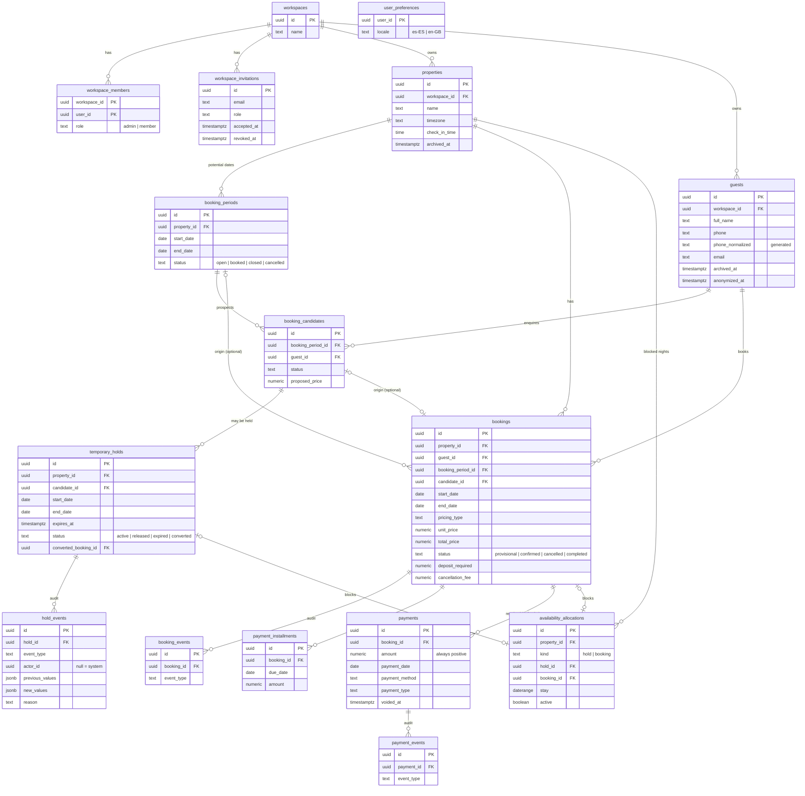

# Architecture

Private, bilingual (es-ES / en-GB) administration tool for a family's vacation rentals.
React + TypeScript + Vite in the browser; Supabase (PostgreSQL + Auth) as the backend; static
hosting on Cloudflare Pages.

## Principles

1. **The database is the authority.** Availability conflicts, state transitions, money rules and
   authorization are enforced in PostgreSQL (constraints, RLS, transactional RPCs). The browser
   only pre-validates for convenience.
2. **History is never deleted.** Holds, bookings and payments are closed, cancelled or voided,
   with an audit event each time. Clients have no `DELETE` privilege on anything.
3. **Language-independent data.** Statuses are stable identifiers (`awaiting_response`,
   `partial_payment`…); translation happens in `src/locales/*.json`.
4. **Dates are dates.** Stay dates are PostgreSQL `date` and `'YYYY-MM-DD'` strings in the
   browser, never passed through the device time zone. Instants are `timestamptz`, shown in the
   property's time zone (default `Europe/Madrid`), 24-hour clock.

## Entity-relationship model



### Differences from the minimum model in the brief

| Change | Why |
|---|---|
| Every business table also carries `workspace_id`, with **composite foreign keys** `(id, workspace_id)` | A row can never reference a guest/property/booking of another workspace, declaratively, and RLS is a single indexed check. |
| `availability_allocations` (new) | One exclusion constraint covers holds *and* bookings (see below). |
| `workspace_invitations` (new) | Invitation-based access; a new sign-up has no membership. |
| `booking_events` (new) | Audit trail for bookings (confirm, edit, cancel, complete), like holds and payments. |
| `properties.check_in_time`, `archived_at`; `guests.archived_at`, `anonymized_at`, `phone_normalized` | Hold cut-off, soft deletion, anonymisation, phone search. |
| `bookings.deposit_required` is an **amount** (0 = none), plus `cancelled_at`, `cancellation_reason`, `cancellation_fee` | The deposit warning needs the agreed amount; cancellations are documented. |
| `payments.voided_by`, `void_reason` | Voids are explained on the row as well as in the audit trail. |

## Availability and concurrency

**What blocks:** an *effective* hold (`status = 'active'` and `expires_at > now()`) and a
`confirmed` or `completed` booking. Periods, candidates, provisional and cancelled bookings never
block. Stays are half-open `[check_in, check_out)`.

**How it is guaranteed:**

1. `availability_allocations` has one row per hold and per blocking booking with a `daterange`
   and an `active` flag, protected by
   `EXCLUDE USING gist (property_id WITH =, stay WITH &&) WHERE (active)`.
   No `now()` appears in any index or constraint.
2. Every RPC that changes availability calls `private.lock_property()`, which
   - checks the caller's membership,
   - takes `SELECT … FOR UPDATE` on the property row (one writer per property at a time),
   - **reconciles expired holds** using `clock_timestamp()` (so time spent waiting for the lock
     counts): expired holds get `status = 'expired'`, their allocation is deactivated and an
     `expired` event with `actor_id = NULL` is written, dated at the deadline.
3. Only then does it check for overlaps (`private.assert_free`) and write, all in the same
   transaction. Converting a hold deactivates the hold's allocation and inserts the booking's
   allocation under that same lock: there is no instant at which the dates are free.
4. Reads use `v_holds` / `v_blocking`, which compute effectiveness with the database clock at
   query time. An expired hold therefore stops blocking at its deadline with no job running and
   regardless of any browser clock. `public.housekeeping_expire_holds()` exists only to write
   the persisted `expired` status earlier (optional `pg_cron`).
5. Clients have `SELECT` only on holds, bookings, allocations, payments, instalments and the
   audit tables. Two guard triggers stop the remaining direct paths: a candidate cannot be set
   to/from `confirmed` and a period's dates cannot move while a hold or booking depends on them.

**Hold deadline rule:** a hold must expire in the future and no later than **check-in day at
the property's `check_in_time` (default 16:00) in the property's time zone**. The cut-off is
computed in SQL with `AT TIME ZONE`, so it is correct across daylight-saving changes.

**Override:** confirming another candidate during somebody's effective hold requires an
**admin**, the explicit id of the hold being overridden and a non-empty reason; the hold is
closed with an `overridden` event. Without those the RPC fails with `DATES_HELD`.

## Money

- `numeric(12,2)` everywhere; amounts are positive, refunds are subtracted in the net.
- `v_bookings` derives: gross receipts, refunds, `net_paid`, `outstanding = total − net_paid`
  (negative = visible credit, never clamped; 0 for cancelled bookings whose retained money is
  simply `net_paid`), `payment_status` (`unpaid`, `partially_paid`, `paid`, `overpaid`; a
  zero-price booking is `paid`, or `overpaid` if money was received), `paid_percent`,
  `due_to_date` and `overdue`.
- **Allocation convention:** receipts cover the oldest instalments first. `overdue` = instalments
  due before today (property time zone) minus `net_paid`, never below zero.
- A refund may not exceed the booking's net receipts; voiding or correcting a payment may not
  leave the net negative either (void the refund first).
- The deposit tracked here is part of the rental price. A refundable damage deposit is not
  modelled and must not be recorded as a booking payment.

### Pricing rules (browser proposal only; the agreed total is always typed or accepted)

| Type | Proposal | Exact when |
|---|---|---|
| `per_night` | nights × rate | always |
| `per_week` | whole weeks × rate + leftover nights × rate ÷ 7 | nights is a multiple of 7 |
| `per_month` | whole calendar months × rate + leftover nights × rate ÷ days in the month where the leftover starts | check-in and check-out are the same day of the month |
| `total` | – | – |

A non-exact proposal is shown as a warning with its formula; nothing is filled in silently and
no 30-day month is assumed.

### Reporting definitions (`src/utils/finance.ts`)

- **Agreed value for a year:** confirmed + completed bookings, split by occupied nights (a stay
  crossing New Year counts in each year proportionally, to the cent).
- **Receipts / refunds / net:** by payment date in the year, voided excluded.
- **Outstanding:** owed on all confirmed + completed bookings, any year; credits excluded.
- **Occupancy:** confirmed + completed nights ÷ (days in the year × properties in scope).
  Candidates, holds, provisional and cancelled bookings never count. If owner-use or maintenance
  blocks are added later they should reduce the denominator.

## Security

- RLS is enabled on all 16 tables. `anon` has no privileges at all. Policies use
  `is_workspace_member()` / `is_workspace_admin()`.
- All RPCs are `SECURITY DEFINER` with `search_path = ''`, fully qualified names, their own
  membership/role check, and `EXECUTE` granted to `authenticated` only (revoked from `PUBLIC`
  and `anon`). Internal helpers live in schema `private`, which is not exposed by the API.
- Views are `security_invoker`, so the caller's RLS applies.
- Only the anon/publishable key is in the browser. No service-role key is used by the app.
- Membership: admins invite an e-mail address; `accept_invitations()` turns pending invitations
  into membership only for a **confirmed** e-mail. The last admin cannot be removed or demoted.
- Guest data is limited to name, phone, e-mail and notes. Contacts can be archived or
  anonymised (personal fields erased, bookings and payments kept). These are technical measures
  and do not by themselves establish legal or tax compliance.

## Frontend

```
src/
  app/            App (routes, gatekeeper), AppContext (workspace, role, property filter), Layout
  components/     ui (modal, badges, states), forms (guest picker, stay, price), AuditList
  features/       auth, dashboard, calendar, prospects, holds, bookings, payments, guests,
                  reporting, settings
  hooks/data.ts   React Query hooks, useAction (mutations), error text
  services/api.ts typed data access (views for reads, RPCs for critical writes)
  lib/            supabase client, i18n, query client
  locales/        es.json, en.json
  types/          database row types
  utils/          dates, money, pricing, finance, availability, format, phone, errors
  tests/          unit tests
supabase/         migrations, seed.sql (development), bootstrap.sql (production)
tests/db/         database integration tests (RLS, concurrency)
e2e/              Playwright tests
scripts/          local PostgreSQL runner and local backend
```

| Route | Screen |
|---|---|
| `/` | Dashboard |
| `/calendar` | Monthly calendar and annual overview |
| `/prospects`, `/prospects/:periodId` | Potential periods, candidates, holds, confirmation |
| `/bookings`, `/bookings/new`, `/bookings/:bookingId` | List, direct booking, detail with payments and schedule |
| `/payments` | Global payment list |
| `/guests`, `/guests/:guestId` | Contacts |
| `/reports` | Yearly financial summary |
| `/settings` | Language, properties, members, account |

**Freshness.** React Query refetches on window focus, on reconnect, when the tab becomes visible
again, every 60 s, after every successful mutation (everything is invalidated), after a conflict
error, and at the moment the next effective hold reaches its deadline. Supabase Realtime is not
used in v1.

**Mutations.** `useAction` disables the submitting control while a request is in flight, shows
nothing as done until the server answers, and keeps the form open with a translated error
otherwise. There is no offline queue; an offline banner says changes are not being saved.

## Decisions taken without asking

- Hold cut-off at 16:00 local check-in time (per-property column, default 16:00).
- Override of another candidate's hold is admin-only.
- Cancelling a booking that came from a prospect reopens the period and sets that candidate to
  `discarded`; other candidates are untouched.
- A discarded candidate must be restored before it can be held or confirmed.
- Members can edit properties; only admins can create them and manage membership.
- User accounts are created by an admin in Supabase Auth (public sign-up should be disabled);
  the in-app invitation grants *access*, it does not send e-mail.
- Polling/refetching instead of Realtime.
